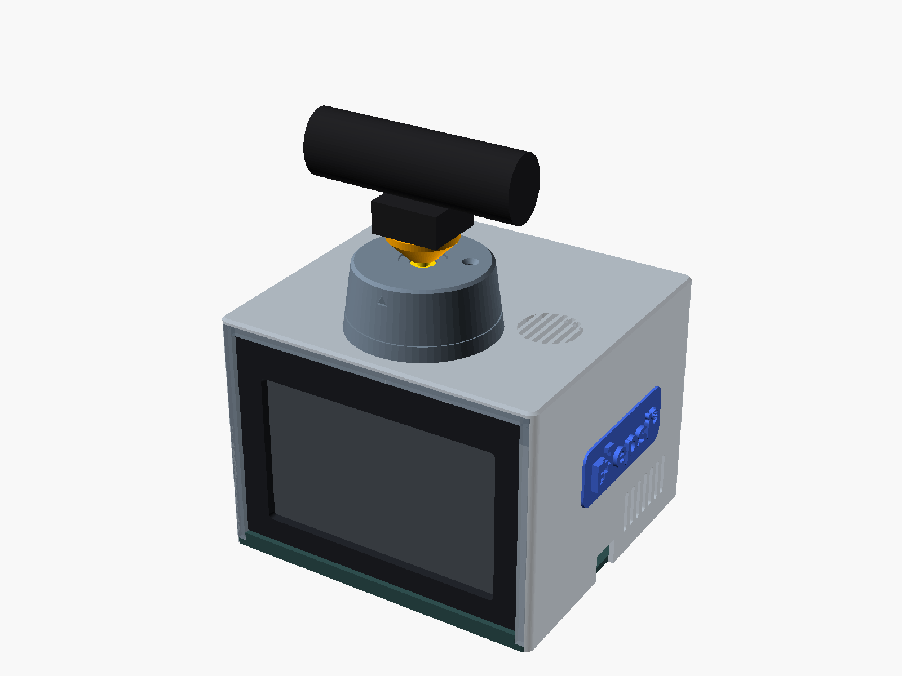
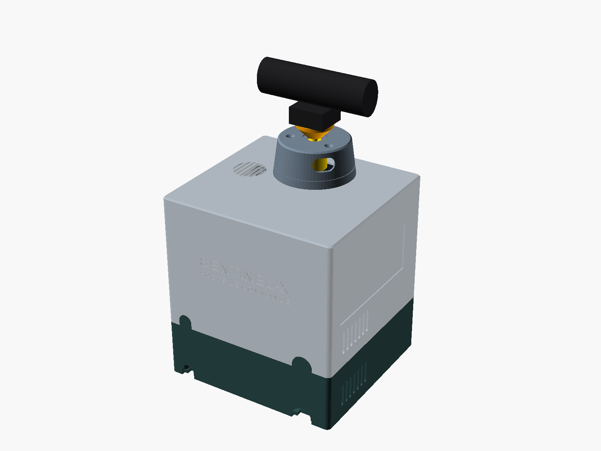
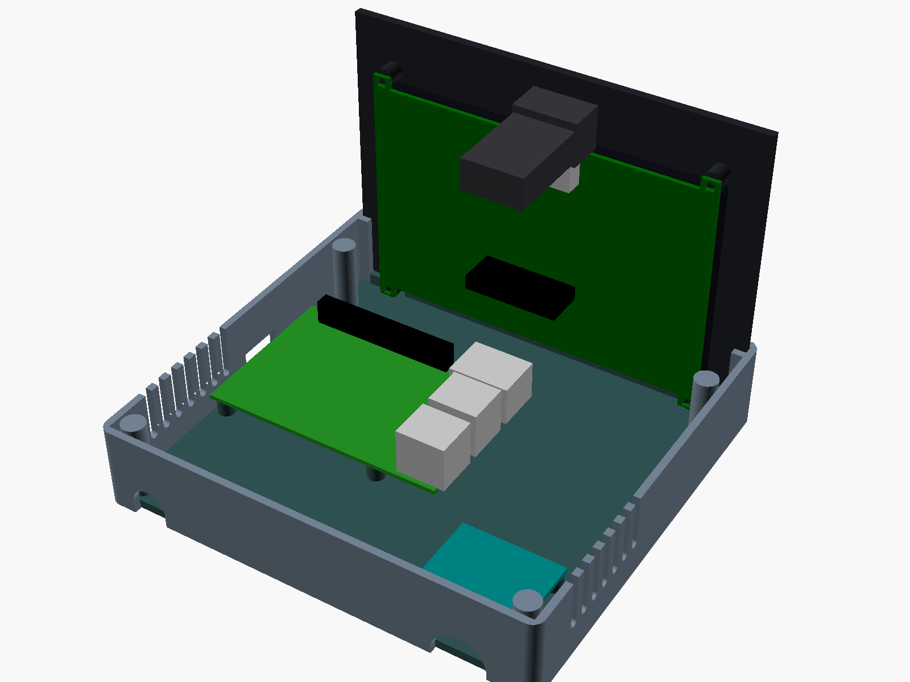
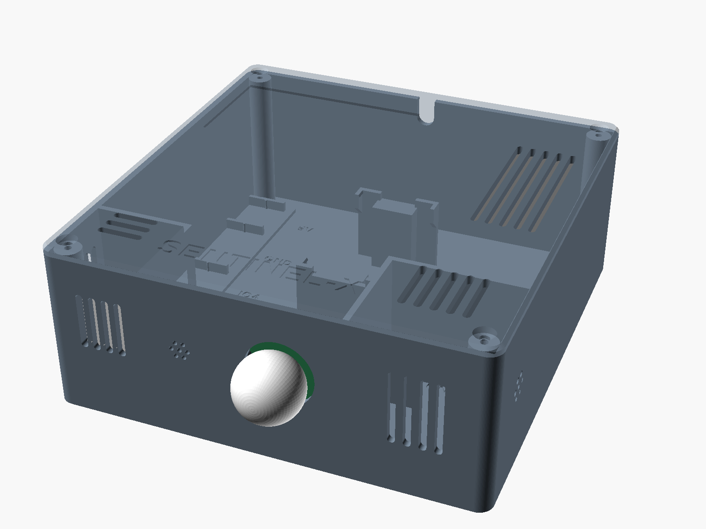
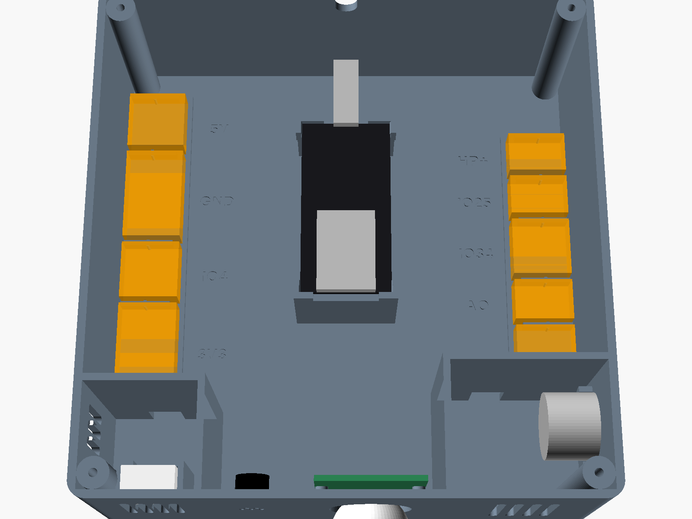
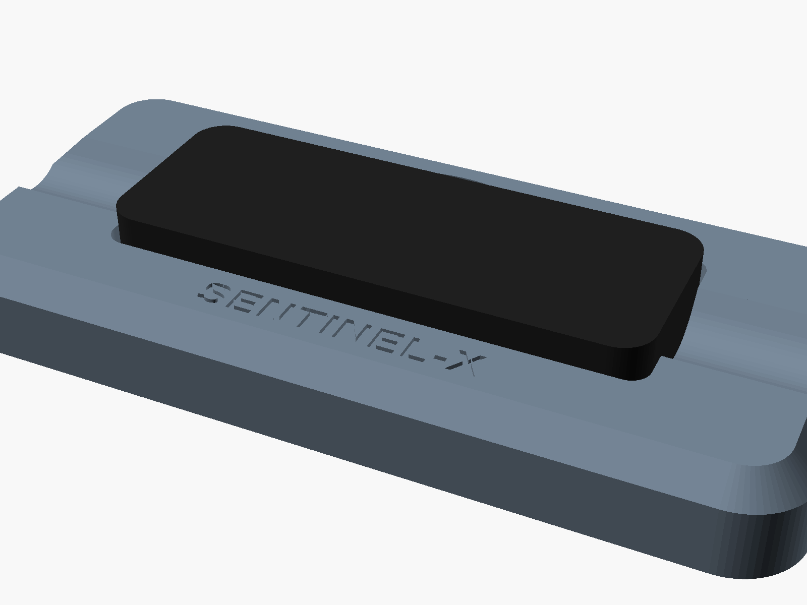

# enclosure/ : les boîtiers à imprimer

Deux boîtiers, le Poste de commande et le Sentinel, plus le support du Leap Motion : sept fichiers STL dans [`stl/`](stl/), chacun déjà posé dans le bon sens pour l'impression. Aucun ne demande de support.

| Objet | Ce qu'il contient | Taille hors tout |
|---|---|---|
| **Poste de commande** | Raspberry Pi 4, écran 5 pouces HDMI 800×480 (SunFounder) en façade, carte ULN2003 ; sur le toit, une tour de 30 mm avec le moteur 28BYJ-48 dedans et la Logitech C920 sur son support | 150 × 140 × 112 mm, 141 mm en haut de la tour, 197 mm en haut de la C920 |
| **Sentinel** | ESP32 sur son support, trois WAGO 221 pour les alimentations, DHT22, MQ-2, PIR HC-SR501, micro CZN-15E, enceinte 70 × 30 mm | 138 × 137 × 61 mm |
| **Support Leap Motion** | Le Leap Motion Controller d'origine, à plat sur le bureau de l'Opérateur | 128 × 58 × 15 mm |

| Poste de commande | Arrière | Intérieur |
|---|---|---|
|  |  |  |

| Sentinel | Intérieur, vu de dessus | Support Leap Motion |
|---|---|---|
|  |  |  |

## Les fichiers

| Fichier | Pièce | Posée sur le plateau par |
|---|---|---|
| `command-post-shell.stl` | Coque : toit et trois murs | le toit |
| `command-post-base.stl` | Socle : le Pi, la carte ULN2003 | le dessous |
| `command-post-bezel.stl` | Façade : la fenêtre de l'écran, les quatre plots où il se visse | la face avant |
| `command-post-tower.stl` | Tour de la caméra : le moteur sous son sommet | le sommet |
| [`Rajout/Porte_clés_EPSI_monochrome_v3.stl`](Rajout/) | Porte-clés EPSI, 70 × 27 mm, collé dans son logement du mur droit du Poste de commande | le dessous |
| `sentinel-base.stl` | Boîte du Sentinel : fond, murs, compartiments, support de l'ESP32, logements des trois WAGO | le fond |
| `sentinel-lid.stl` | Couvercle du Sentinel, avec le cadre de l'enceinte | le dessus |
| `leap-stand-stand.stl` | Support du Leap Motion | le dessous |

## Impression

Sur la Creality K2 Plus du myDiL (350 mm de plateau : chaque pièce passe en une fois).

- **Matière** : PLA pour le Poste de commande et le Leap. **PETG** de préférence pour le Sentinel : la chauffe du MQ-2 dégage près d'un watt dans son compartiment.
- Couches de 0,2 mm, 3 périmètres, remplissage 15 à 20 % (gyroïde), sans support, sans bordure.
- Au plus 750 g de filament pour le tout (le volume plein des pièces), moins avec le remplissage.

## Visserie et petit matériel

| Pour | Quoi |
|---|---|
| Le Pi sur le socle | 4 vis M2,5 × 6 |
| Le socle sous la coque | 4 vis M3 × 12 tête fraisée, par en dessous |
| La tour sur le toit | 3 vis M3 × 10, par l'intérieur du boîtier |
| Le moteur dans la tour | 2 vis M3 × 8 tête fraisée et 2 écrous M3 |
| L'écran sur la façade | 4 vis M2,5 × 8, par les trous de ses oreilles |
| Le câble HDMI de l'écran | Un adaptateur HDMI coudé à 90°, mâle-femelle, dont la sortie part vers l'arrière (à l'opposé de la vitre) |
| L'alimentation de l'écran | 2 fils Dupont mâle-femelle, ou un câble micro-USB coudé |
| La carte ULN2003 | 4 vis M3 × 6, ou un carré d'adhésif double face mousse si ses trous ne tombent pas (prévus à 29,5 × 27 mm) |
| Le couvercle du Sentinel | 4 vis M3 × 12 tête fraisée |
| Les branchements du Sentinel | Trois WAGO 221 : 1 × 221-415 (5 pôles), 2 × 221-413 (3 pôles). Des câbles Dupont mâle-femelle (côté femelle sur la broche, côté mâle dans le WAGO) et femelle-femelle (d'une broche à une autre, ou à une patte de résistance). Les résistances de 100 Ω, 10 kΩ et 20 kΩ, un peu de ruban isolant |
| Le PIR | 2 vis M2 × 6, ou un point de colle chaude |
| Le MQ-2 | 4 vis M2,5 × 6, par les trous de ses coins |
| Le micro, l'enceinte | Colle chaude |
| Le porte-clés EPSI | Colle cyanoacrylate, ou adhésif double face fin, dans son logement |
| Sous chaque boîtier et sous le Leap | 4 patins caoutchouc de 10 mm |

## Montage du Poste de commande

1. **Écran sur la façade.** Vitre contre la façade, **son connecteur HDMI en haut** : les quatre oreilles de sa carte tombent sur les quatre plots. Quatre vis M2,5 × 8 ; serrées, elles plaquent la vitre contre la fenêtre.
   L'adaptateur HDMI coudé se branche dessus, sa sortie vers l'arrière : le câble passe sous le toit, au-dessus du Pi, et redescend au fond vers le micro-HDMI 1. Il reste 20 mm entre le haut de la carte et le toit.
2. **Pi sur le socle.** Carte SD vers la droite (l'encoche du mur droit la laisse accessible), connecteur GPIO vers l'avant, ports USB et Ethernet vers la gauche. Quatre vis M2,5.
3. **Carte ULN2003** sur les quatre plots du coin arrière gauche.
4. **Moteur dans la tour.** Son axe sort par le trou du sommet, le capot de ses fils vers l'arrière. Deux vis fraisées par le dessus, les écrous dessous, sur ses pattes.
   **Tour sur le toit.** Elle se pose dans son logement, le triangle gravé vers l'avant (ses trois vis ne tombent que dans ce sens), et se visse par l'intérieur de la coque avec trois vis M3 × 10. Le fil du moteur descend dans le boîtier par le trou du toit.
5. **Support de la caméra** : celui que l'équipe a déjà imprimé (`support_c920_28byj48.stl`), enfoncé sur l'axe du moteur. Le haut de la tour est creusé autour de l'axe : son cône ne frotte pas.
6. **Webcam.** La C920 se visse sur le pas de vis du support, son clip replié dessous, **sa lentille au-dessus du triangle gravé** sur la tour : elle regarde droit devant. C'est le zéro du moteur, à refaire avant chaque démarrage (il compte ses pas depuis là). Son câble entre dans la tour par le trou à l'arrière gauche, juste sous le support, et descend jusqu'à un port USB du Pi. Laisse-lui du mou : la caméra tourne d'un quart de tour de chaque côté.
7. **Câblage**, comme sur [`docs/cablage/raspberry-pi.html`](../docs/cablage/raspberry-pi.html) : broches 31, 33, 35, 37 vers IN1 à IN4, 39 vers −, 4 vers + ; le moteur dans la prise blanche de l'ULN2003 ; l'écran sur le micro-HDMI 1. On n'enfiche pas l'écran sur le GPIO comme le prévoit SunFounder (avec son adaptateur HDMI en U) : son connecteur couvrirait les broches 1 à 26, dont la 4 du moteur. Il s'alimente par deux fils Dupont mâle-femelle, de la broche 2 (5 V) et de la broche 6 (GND) du Pi vers les mêmes broches de son connecteur noir, au dos ; ou par son micro-USB sur un port USB du Pi, avec un câble coudé (11 mm seulement jusqu'au mur droit). Si l'image est à l'envers, ajouter `,rotate=180` après `video=HDMI-A-2:800x480M@60D` dans `/boot/firmware/cmdline.txt`. Le câble USB de l'ESP32 et, si besoin, l'Ethernet passent dans l'encoche arrière gauche, l'alimentation USB-C dans l'encoche arrière droite. Toutes les fiches restent dedans : à l'arrière ne sortent que l'alimentation et le câble de l'ESP32, plus l'Ethernet s'il est branché.
8. **Fermeture.** La tour vissée avant (ses vis sont au-dessus de la façade), la façade debout dans la rainure à l'avant du socle, on descend la coque par-dessus : la façade glisse dans les rainures des murs jusqu'à celle du toit. Quatre vis M3 × 12 par-dessous.
9. **Porte-clés EPSI** dans son logement, sur le mur droit : le logo vers l'avant, le trou d'anneau vers l'arrière. Un point de colle cyanoacrylate, ou de l'adhésif double face fin.

## Montage du Sentinel

1. **ESP32.** Les fiches Dupont d'abord, sur ses broches, hors de la boîte. Puis il descend entre ses deux supports, **son USB vers le mur du fond**, et se clipse sous leurs petites lèvres. Ses fiches pendent dessous : 26 mm de place.
   **WAGO** dans leurs logements, leviers en haut, ouvertures vers l'ESP32 : le 5 pôles contre le mur gauche, en face des broches GND ; les deux 3 pôles contre le mur droit, en face des broches 3V3 (devant) et 5V (au fond). Le nom de chacun est gravé à côté, dans le fond :

   | Gravé | WAGO | Ce qui y entre |
   |---|---|---|
   | GND | 221-415 | Un GND de l'ESP32, GND du PIR, du MQ-2 et du CZN-15E, le fil noir de l'enceinte |
   | 3V3 | 221-413 | 3V3 de l'ESP32, VCC du DHT22, VCC du CZN-15E |
   | 5V | 221-413 | 5V de l'ESP32, VCC du MQ-2, VCC du PIR |

   Le reste va broche à broche, par un câble Dupont femelle-femelle : DATA du DHT22 sur IO4, son GND sur un autre GND de l'ESP32, OUT du CZN-15E sur IO26, OUT du PIR sur IO27.
   Les résistances se branchent sans soudure, chaque patte dans la fiche femelle d'un câble :
   - **Enceinte** : IO25 → 100 Ω ; le fil rouge enroulé serré sur l'autre patte, un tour de ruban isolant par-dessus.
   - **Pont du MQ-2** : AO → 10 kΩ, et 20 kΩ → le troisième GND de l'ESP32. Les deux autres pattes se rejoignent : celle de la 20 kΩ enroulée serrée (cinq tours) sur celle de la 10 kΩ, dont le bout entre dans le câble d'IO34. Du ruban sur l'épissure.
   - **DHT22** : plus de 10 kΩ. Le firmware active la résistance de tirage interne d'IO4 (la bibliothèque DHT le fait toute seule) : elle suffit avec des câbles de 20 cm au plus.

2. **DHT22** glissé par le haut dans son support, grille contre les fentes, posé sur ses deux piliers : ses quatre fiches Dupont passent dessous. Ses fils sortent du compartiment par le passage au ras du fond.
3. **MQ-2** : ses quatre fiches Dupont d'abord, sur ses broches coudées. Il se pose à plat sur ses quatre plots, capsule vers le haut, broches vers l'arrière : ses fiches descendent dans la fente de la cloison, ouverte par le haut. Quatre vis M2,5 × 6 par les trous de ses coins. La capsule arrive à 3 mm sous les fentes du couvercle : sa chaleur sort tout droit, l'air entre par les fentes basses de la façade et du mur droit.
4. **PIR** : le dôme sort par le trou de la façade, la carte se visse sur les deux plots (M2) ou se colle. Ses deux potentiomètres et son cavalier restent accessibles couvercle ouvert.
5. **Micro CZN-15E** : ses trois fiches Dupont d'abord, sur ses broches coudées. Sa capsule dans le petit berceau, face aux trous, sa carte à plat vers l'arrière, posée sur son plot : un point de colle chaude, ou une vis M3 si son trou tombe dessus.
6. **Enceinte** dans son cadre sous le couvercle, sa face contre les fentes, un cordon de colle chaude autour. Elle descend à 38 mm du fond, au-dessus des WAGO de droite. Fils assez longs pour ouvrir le couvercle.
7. Une fois câblé (les broches de [`docs/cablage/esp32.html`](../docs/cablage/esp32.html), les jonctions du tableau ci-dessus), un bout de mousse ou de ruban bouche le passage du DHT22 et la fente du MQ-2 : la chaleur du MQ-2 reste dans son compartiment, loin du DHT22.
8. Le câble USB couché dans l'encoche du fond, le couvercle se visse aux quatre coins (M3 × 12 fraisées).

## Support Leap Motion

Le capteur se pose dans le creux, sa LED verte vers l'Opérateur ; son câble sort par l'un ou l'autre bout. L'encoche à l'arrière sert à le soulever. Le dessus du capteur dépasse le bord : rien ne gêne son champ de vision.

## Gravure laser

Le sujet demande des plaques gravées (logo, consignes, numéro de série) sur le boîtier. Deux logements de 1 mm de profondeur les attendent :

- Poste de commande, mur gauche : **100 × 40 mm**, plaque à découper à 99,4 × 39,4 mm ;
- Sentinel, couvercle : **70 × 40 mm**, plaque à 69,4 × 39,4 mm.

En plexiglas ou contreplaqué de 3 mm sur la Creality Falcon A1, collées.

## Ce qui a été supposé, à vérifier avant d'imprimer

Toutes ces cotes sont en tête des fichiers `.scad`. Après un changement, `./build.sh` refait les STL et les aperçus (OpenSCAD 2024 ou plus récent : `brew install --cask openscad@snapshot`).

| Cote | Valeur prise | Fichier, variable | Si c'est faux |
|---|---|---|---|
| **Écran 5 pouces SunFounder** (la carte Waveshare 5inch HDMI LCD Rev 2.1, comme la Joy-IT RB-LCD-5) : carte, oreilles, zone affichée | Carte 121,1 × 78 mm ; ses quatre oreilles arrondies la portent à 92,3 mm de haut, trous Ø 3 à 115,1 × 83,9 mm ; zone affichée 110,7 × 67,4 mm, décalée de 2,2 mm vers la prise HDMI ; 6,2 mm de la vitre à la carte. D'après le modèle 3D de Waveshare | `command-post.scad`, `scr`, `scr_holes`, `scr_ear`, `scr_view`, `scr_view_off`, `scr_glass` | Mesurer l'entraxe des trous : seule la façade change, sauf si l'écran est plus grand |
| Place pour l'adaptateur HDMI coudé | 20 mm au-dessus de la carte | `hdmi_room` | Avec un câble droit sans adaptateur, 45 mm : le boîtier grandit de 25 mm |
| ESP32 DevKitC V4 d'AZ-Delivery | 56 × 28 mm | `sentinel.scad`, `esp` | Les supports s'écartent ou se rapprochent seuls |
| WAGO 221 | 18,7 / 29,9 mm de large (3, 5 pôles), 18,6 mm de profondeur | `wago_w`, et leur liste dans `wagos` | Un point de colle chaude |
| Trous de la carte ULN2003 (la carte classique : puce ULN2003AN, entrées IN1 à IN7, LED A à D, prise blanche à 5 fils) | 29,5 × 27 mm | `uln_holes` | Adhésif mousse sur les plots |
| Pied carré de la lentille du PIR | 4 mm entre le mur et sa carte | `sentinel.scad`, `pir_skirt` | Un point de colle |
| Module MQ-2 Flying Fish | Carte 32 × 20 mm, trous de ses coins à 15 × 27 mm, capsule Ø 19,8 et 17 mm de haut, son centre à 12,5 mm du bout de la carte, broches coudées sous l'autre bout. D'après les photos du vendeur | `sentinel.scad`, `mq_pcb`, `mq_holes`, `mq_can`, `mq_can_at` | Un point de colle sur les plots |
| PIR HC-SR501 | Carte 32 × 24 mm, lentille Ø 23, trous M2 à 28 mm. D'après la fiche du vendeur | `pir`, `pir_skirt` | Un point de colle |
| Module son CZN-15E | Carte 32 × 17 mm, micro Ø 9,7 couché à un bout, 3 broches coudées à l'autre, un trou Ø 3. D'après les photos du vendeur | `czn_pcb`, `czn_mic` | Colle chaude sur le plot |
| Leap Motion d'origine | 80 × 30 mm | `leap-stand.scad`, `leap` | — |

Mesurés : l'enceinte (70 × 30 × 18 mm, par l'équipe) et le support de caméra déjà imprimé (Ø 30 mm, cône de 45°, axe à méplats de 6,5 mm de profondeur). La C920 d'après la fiche de Logitech : 94 × 24 × 29 mm, 162 g.

Les sources sont les fichiers `.scad` : `common.scad` (outils partagés), `command-post.scad`, `sentinel.scad`, `leap-stand.scad`. Chacun prend `part="..."` : une pièce posée pour l'impression, `assembly` le boîtier monté avec ses composants en couleur, `inside` son intérieur.
